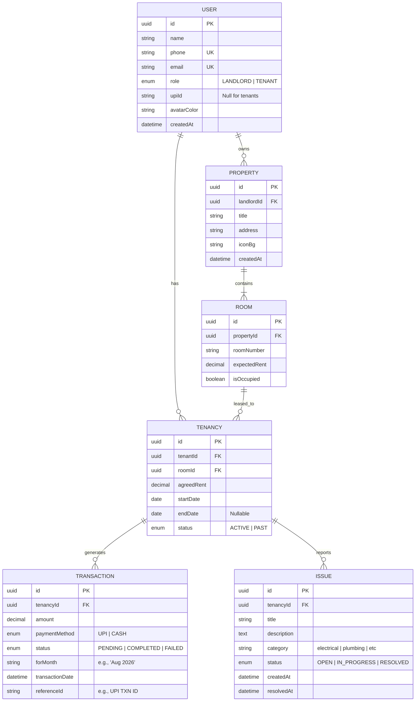

# ROOMHAIJI - Backend & API Architecture Plan

Based on the analysis of the frontend Expo app, this document outlines the proposed database schema and RESTful API structure for the `ROOMHAIJI` backend.

## 1. Entity-Relationship Diagram (ERD)

## 2. Database Schema (Prisma/SQL Reference)

The schema centers around the `User` having two potential roles, linked to `Properties` via `Rooms` and `Tenancies`.

### `users`
| Column | Type | Constraints | Description |
| :--- | :--- | :--- | :--- |
| `id` | UUID | Primary Key | Unique user identifier |
| `name` | Varchar | Not Null | Full name |
| `phone` | Varchar | Unique, Not Null | Used for OTP login |
| `email` | Varchar | Unique, Nullable | Optional email |
| `role` | Enum | Not Null | `LANDLORD` or `TENANT` |
| `upiId` | Varchar | Nullable | Required for landlords to receive rent |

### `properties`
| Column | Type | Constraints | Description |
| :--- | :--- | :--- | :--- |
| `id` | UUID | Primary Key | |
| `landlord_id` | UUID | Foreign Key (`users.id`) | The landlord who owns it |
| `title` | Varchar | Not Null | e.g., "Sharma Building" |
| `address` | Text | Not Null | Full address |
| `icon_bg` | Varchar | Nullable | Hex color for UI |

### `rooms`
| Column | Type | Constraints | Description |
| :--- | :--- | :--- | :--- |
| `id` | UUID | Primary Key | |
| `property_id` | UUID | Foreign Key (`properties.id`)| |
| `room_number` | Varchar | Not Null | e.g., "204" |
| `expected_rent` | Decimal | Not Null | Standard rent for the room |

### `tenancies` (Links Tenants to Rooms)
| Column | Type | Constraints | Description |
| :--- | :--- | :--- | :--- |
| `id` | UUID | Primary Key | |
| `tenant_id` | UUID | Foreign Key (`users.id`) | |
| `room_id` | UUID | Foreign Key (`rooms.id`) | |
| `agreed_rent` | Decimal | Not Null | Actual monthly rent |
| `start_date` | Date | Not Null | Move-in date |
| `status` | Enum | Not Null | `ACTIVE` or `PAST` |

### `transactions` (Rent Payments)
| Column | Type | Constraints | Description |
| :--- | :--- | :--- | :--- |
| `id` | UUID | Primary Key | |
| `tenancy_id` | UUID | Foreign Key (`tenancies.id`) | Context of the payment |
| `amount` | Decimal | Not Null | |
| `payment_method`| Enum | Not Null | `UPI`, `CASH` |
| `status` | Enum | Not Null | `COMPLETED`, `PENDING` |
| `for_month` | Varchar | Not Null | e.g., "08-2026" |
| `transaction_date`| Timestamp| Not Null | |

### `issues` (Maintenance Requests)
| Column | Type | Constraints | Description |
| :--- | :--- | :--- | :--- |
| `id` | UUID | Primary Key | |
| `tenancy_id` | UUID | Foreign Key (`tenancies.id`) | Context of the request |
| `title` | Varchar | Not Null | "Fan not working" |
| `category` | Enum | Not Null | `ELECTRICAL`, `PLUMBING`, etc. |
| `status` | Enum | Not Null | `OPEN`, `IN_PROGRESS`, `RESOLVED` |

---

## 3. RESTful API Structure

Based on the frontend app's features, here is the recommended API routing structure. All routes beneath `/api/` should require an authorization token (JWT) except for the `/auth` login routes.

### Auth & User Profile
- `POST /api/auth/send-otp` : Send OTP to a phone number.
- `POST /api/auth/verify-otp` : Verify OTP and return JWT + user profile.
- `GET /api/users/me` : Fetch current user profile.
- `PUT /api/users/me` : Update profile details (UPI ID, name, avatar).

### Properties & Rooms (Landlord Facing)
- `GET /api/properties` : Get all properties for the logged-in landlord.
- `POST /api/properties` : Add a new property.
- `GET /api/properties/:id` : Get property details including rooms overview.
- `POST /api/properties/:id/rooms` : Add a room to a property.

### Tenants & Tenancy
- `GET /api/tenants` : Get all active tenants under the landlord.
- `POST /api/tenants/onboard` : Landlord creates a new tenant profile and assigns them to a room (creates `User` + `Tenancy`).
- `GET /api/tenancies/me` : (For Tenants) Get their current lease details.

### Payments & Transactions
- `GET /api/transactions` : 
  - *If Landlord:* Get all incoming payments across properties.
  - *If Tenant:* Get their own payment history.
- `POST /api/transactions/cash` : Landlord manually records a cash payment.
- `POST /api/transactions/upi/verify` : Verify a UPI payment transaction reference.
- `GET /api/transactions/due` : Fetch pending/overdue rent for the current month.
- `GET /api/receipts/:transactionId` : Generate/fetch a receipt for a specific payment.

### Issues (Maintenance)
- `GET /api/issues` :
  - *If Tenant:* View their reported issues.
  - *If Landlord:* View all issues across their properties.
- `POST /api/issues` : Tenant reports a new issue.
- `PATCH /api/issues/:id/status` : Landlord updates the status of an issue (e.g., to "RESOLVED").
